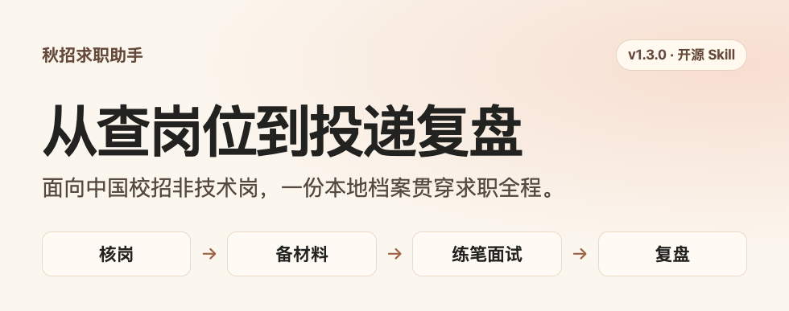
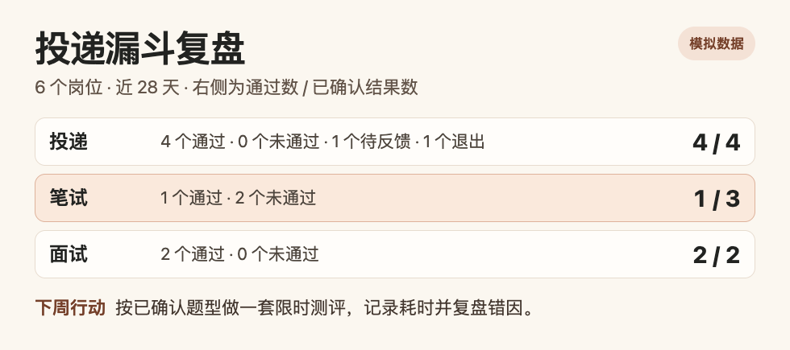

# 秋招求职助手



面向中国校招非技术岗的开源 Skill，适合准备秋招、春招、补录或实习的同学。给它一个岗位说明和一到两段真实经历，就能先判断资格，再准备一份可编辑的投递材料。之后可以用同一份本地档案继续练笔面试、比较 Offer 和复盘投递。

**[下载 v1.3.0 ZIP](https://github.com/isook527/campus-recruiting-skill/releases/download/v1.3.0/campus-recruiting-skill-v1.3.0.zip)** · [正式 Release 和校验文件](https://github.com/isook527/campus-recruiting-skill/releases/tag/v1.3.0) · [版本记录](CHANGELOG.md)

This open-source agent skill helps you prepare and track campus job applications in China. It’s for students and recent graduates targeting non-technical roles. Download and unzip a release, then copy the `campus-recruiting-skill` folder into your agent’s skills directory.

## v1.3.0 能帮你做什么

| 你想做什么 | 给 Skill 什么 | 会得到什么 |
| --- | --- | --- |
| 查岗位、安排投递 | 城市、毕业年月、岗位方向，或一条 JD | 资格、截止时间、官网和网申证据，以及本周投递顺序 |
| 准备投递包 | 一个岗位和一到两段真实经历 | 可编辑简历、网申字段稿、改写依据、附件清单和三道追问 |
| 练笔面试、比较 Offer | 目标岗位、面试轮次，或已脱敏的书面条件 | 分轮次练习与评分，或一份可对照的条件表和待核问题 |
| 继续上次的进度 | 已保存的本地档案或投递库 | 沿用已确认的事实，分开统计待反馈、主动退出和已知结果，给出下一步 |

## 三步安装

1. 下载 ZIP 并解压。确认目录结构为 `campus-recruiting-skill/SKILL.md`。
2. 把整个 `campus-recruiting-skill` 目录放到对应位置。Codex 使用 `~/.agents/skills/`，Claude Code 使用 `~/.claude/skills/`。安装过旧版时，先备份旧 Skill。个人投递库放在单独的目录。
3. 开启新对话。在 Codex 中输入 `$campus-recruiting-skill`，或让 Agent 读取 [SKILL.md](SKILL.md) 并按其中流程执行。

[安装路径参考](https://developers.openai.com/api/reference/cli)

> 这是岗位说明和我的两段经历。请先核对资格，再给我一份可编辑简历、网申字段稿和三道面试追问。

实时核岗需要 Agent 可访问网页。只有 JD 时仍可准备草稿，网申状态保留为待核。批量校验、档案和投递记录脚本使用 Python 3.9+ 标准库。

## 用一个模拟案例走一遍

以下岗位、经历和统计均为合成示例。第一步和第二步使用一份综合职能岗 JD，第三步用六条模拟投递演示漏斗。

### 01 · 判断现在该投还是备料

候选人已知的届次和学历符合。六级或同等外语证明、网申开放状态还待核。此时可以先准备材料，待官网和网申页确认岗位开放、资格核对无误后再由本人投递。


### 02 · 把真实经历写进投递包

简历沿用班费记录和公示这两项已知事实。投递包展示哪些措辞有证据、哪些字段还要补，并给出可练的追问。 [打开完整示例](examples/application.md)


### 03 · 找到下周最值得练的一关

这六条模拟记录中，笔试有三个已确认结果，一个通过。另有一条仍待反馈、一条主动退出，均单独计数。Skill 给出的行动是用已确认的题型做一套限时题，再按错因复盘。 [查看漏斗使用说明](references/application-log.md#找到最弱的一关)



<details>
<summary>继续看面试练习、岗位实操和跨会话记录</summary>

**面试复练**。同一道题答两次，用同一套标准比较动作、证据和表达。


**岗位实操**。从费用台账中找出金额不符、缺凭证和重复凭证。


**跨会话继续**。告诉 Agent 原来的本地数据库路径，读回上次的阶段、简历版本和下一步。旧 SQLite 记录在追加前可按[迁移说明](references/application-log.md)备份升级。


</details>

## 可以直接复制的提问

- **排求职季**。我想走暑期留用和正式秋招两条线，用我的毕业年月和意向城市排出本月需要核验的窗口。
- **准备投递包**。按这份 JD 和我的经历写一份可编辑的投递包，把资格待核项和需要本人确认的字段列出来。
- **复盘投递**。用我指定的本地投递库看近 28 天，区分待反馈和明确未通过，给我下周一个优先动作。

如果希望下次接着聊，可以在选定的私人目录创建[本地求职档案](references/candidate-profile.md)，以后给 Agent 同一个路径。

```bash
python3 scripts/candidate_profile.py 我的求职档案.local.json init
```

## 内容

- [查岗、核验与去重](references/job-verification.md) · [官方来源导航](references/official-sources.md)
- [全季节奏与渠道](references/season-and-channels.md) · [共享求职档案](references/candidate-profile.md) · [漏斗诊断](references/application-log.md#找到最弱的一关)
- [投递优先级](references/application-prioritization.md) · [投递包和网申字段稿](references/application-packet.md) · [八类行业与赛道流程](references/industry-processes.md)
- [七天求职行动](references/action-guide.md) · [投递前检查与防骗](references/application-safety.md) · [本地行动表](templates/local-tracking.md)
- [模拟经历案例](references/cases/index.md) · [简历证据卡、三份示范与一分钟自我介绍](references/resume-and-evidence.md) · [三类可编辑简历](templates/resume.md)
- [面试题与追问](references/interview.md) · [分行业与轮次题库](references/interview-question-bank.md) · [故事库和能力矩阵](references/story-matrix.md) · [模拟面试评分](references/interview-coaching.md) · [三个方向的实操题](references/practice.md)
- [笔试与测评](references/assessments.md) · [公司调研卡](references/company-research.md) · [Offer 比较](references/offer-decision.md) · [签约、背调与体检](references/signing.md)
- [本地投递记录和每周复盘](references/application-log.md) · [行为回归](evals/README.md) · [简历质量盲评](evals/quality/README.md)

## 评估现状

- 简历质量盲评共 9 对，v1.3.0 为 **4 胜、4 平、1 负**。评估使用 3 个合成案例和 1 名模型评审。
- 22 条行为用例进行了 3 轮短答压力测试，共 66 次。**20/66** 满足全部必需项，**65/66** 无禁止项。

见[原始评估记录](evals/quality/results-v1.3.0.md)。

## 声明

本项目为非官方开源项目，与文中引用的任何招聘方、平台或机构无隶属或合作关系。所引名称和商标归各自权利人。内容不构成法律、劳动或职业咨询意见。签约等事项以书面文件和专业意见为准。

## 适用范围

适用于中国校园招聘中的非技术岗。国考、省考、选调和事业单位公开招聘按对应主管机关的当期公告查询。实时机会每次重新查验。来源导航只用于起步，历史线索、已经关闭的公告和待核岗位不混入实时结果。招聘方原文与站点遵循各自权利，仓库整理的是自有案例、模板、核验方法和必要链接。

招聘信息可能更新或遗漏，录用由招聘方决定。材料供求职准备与核对，资格、安排和签约条款以当期公告及书面文件为准。本人负责登录、填写敏感字段、投递和签约。

## 自检

维护时运行 `python3 -m unittest discover -s tests -v`。测试覆盖岗位核验、投递包的事实引用、跨进程恢复和重复写入。个人记录保存在用户选定的本地文件中。运行 `python3 scripts/check_sources.py` 可查看哪些导航入口和带核验日期的参考链接需重新核对。

命令行写入投递记录时，先把事件写进 JSON 文件，再运行 `python3 scripts/application_log.py 本地记录.sqlite3 record 事件.json`。可用 `record --help` 查看参数。岗位校验和投递包输入格式可查[岗位字段](references/job-verification.md#结构化核验记录)和[事实字段](references/application-packet.md#生成-markdown-和排序)。

运行 `python3 scripts/release.py` 可核对版本，并在 `dist/` 生成 ZIP 和 `SHA256SUMS`。

发布资产旁提供 SHA-256 校验文件。下载两份文件到同一目录后，可用 `shasum -a 256 -c SHA256SUMS` 校验。

本仓库的自有内容和代码按 [MIT License](LICENSE) 提供。
