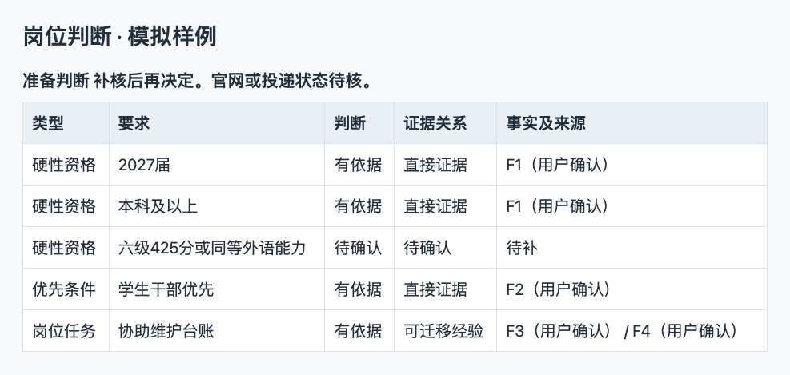
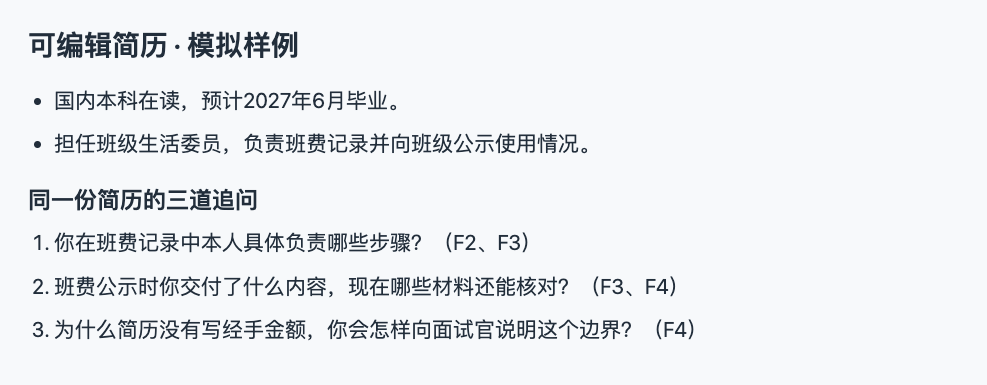
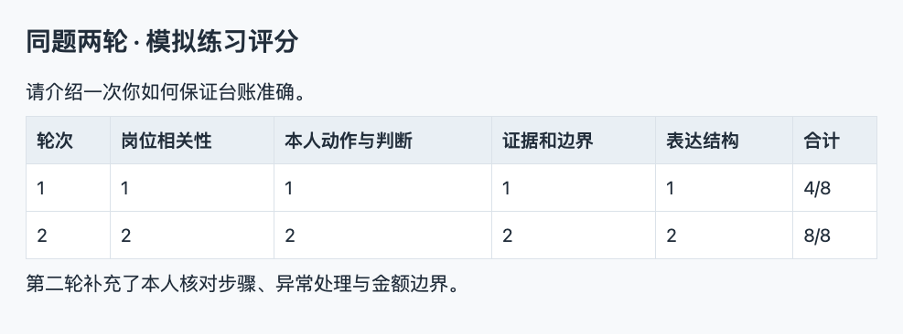
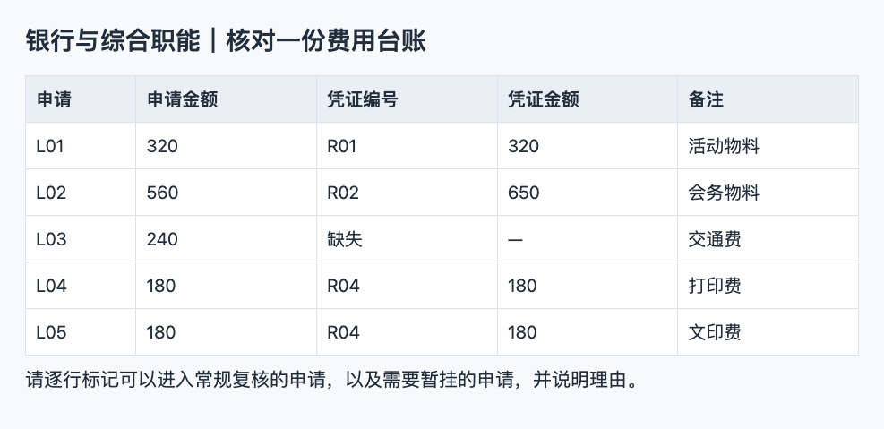
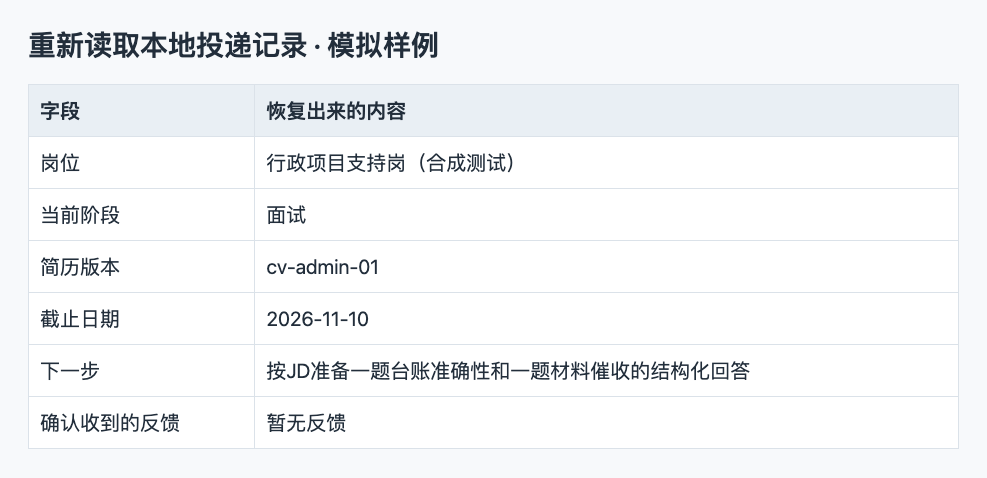

# 秋招求职助手

给非技术岗应届求职者用的免费开源 Skill。它在 Agent 对话里完成岗位核验、筛选、简历改写、面试练习和投递跟踪。所有材料随源码开放，无需付费、激活或登录专用工作台。

发一个岗位链接和一到两段真实经历，即可开始准备一份针对该岗位的投递包。适合运营市场、银行与综合职能、人力行政和项目支持等方向。

[下载 v1.1.1 测试版 ZIP](https://github.com/isook527/campus-recruiting-skill/releases/download/v1.1.1/campus-recruiting-skill-v1.1.1.zip) · [版本记录](https://github.com/isook527/campus-recruiting-skill/releases)

## 三步开始

1. 下载上方 ZIP 并解压，确认 `campus-recruiting-skill/` 下面直接包含 `SKILL.md`。从 Git 克隆的读者可以使用默认分支。
2. 把整个文件夹放进对应的 Skills 目录。Codex 使用 `~/.codex/skills/`，Claude Code 使用 `~/.claude/skills/`。装过旧版时，先备份旧 Skill 目录，再替换整份文件夹。个人投递记录放在单独的本地目录。
3. 重新打开工具。在 Codex 对话输入 `$campus-recruiting-skill`。也可以直接让 Agent 读取 [SKILL.md](SKILL.md) 并按里面的流程处理。询问已安装版本时，Skill 会读取 `metadata.version`。

> 这是我的岗位说明和两段真实经历。帮我核对硬性资格，做一份可编辑简历、改写依据、附件检查和三道追问。

实时岗位核验使用 Agent 已有的网页工具。只贴出 JD 时也可以先准备简历，网申状态保持待核。批量校验和本地投递记录使用 Python 3.9+ 标准库。

## 走完一次模拟投递

下面用一份综合职能岗 JD 和一段班委经历演示。岗位、候选人、评分和投递记录都来自模拟测试。

### 先判断要不要投

候选人符合已给出的届次和学历要求，六级或同等外语证明待确认，网申也未核实。结果停在「补核后再决定」。岗位偏好和硬性资格各自列出。

### 给一版可编辑的投递包

简历沿用班费记录和公示这两个已知事实。完整投递包附每条改写依据、投递前检查和三道面试追问。

### 同题练两轮

先回答，再沿本人动作和证据追问。第二轮按同一量表给反馈，能看出回答具体在哪一项有变化。图中的分数仅对应两份模拟回答。

### 做一次岗位实操

试着核对五笔费用，找出金额不符、缺凭证和重复凭证。提交后按评分表反馈。运营、人力行政方向也各有一题。

### 下次继续同一份准备

在新对话指定原来的本地数据库，就能读回岗位阶段、简历版本和下一步。没有收到的反馈保持空缺。

## 可以这样说

| 目标 | 给 Agent 的话 |
| --- | --- |
| 查现在还能投的 | 我 2027 年 6 月毕业，上海或杭州，想找内容运营和市场校招。只列你刚刚核验过官网与投递页的岗位。 |
| 清理旧表 | 帮我把这份秋招表分成当前可投、未开始、明确结束和待核。只在结果表排除失效记录，保留我的原文件。 |
| 判断值不值得投 | 这两个岗位帮我排一下。分开写硬性条件、优先项和本人经历。缺什么信息就告诉我先核哪一条。 |
| 做一份投递包 | 这是一份 JD 和我的两段经历。给我一版能编辑的简历、每条改写依据、附件检查和三道追问。 |
| 模拟面试 | 我想投银行综合岗。一次问一题，根据我的回答追问。用同一套标准给我两轮练习反馈。 |
| 做岗位实操 | 给我一道人力行政排期题，等我交卷再逐项评分。 |
| 继续上次投递 | 读取我选的本地投递记录，找出本周最早到期的行动，按实际反馈帮我复盘。 |

## 内容

- [查岗、核验与去重](references/job-verification.md) · [官方来源导航](references/official-sources.md)
- [岗位判断、排序与投递包](references/application-packet.md)
- [七天求职行动](references/action-guide.md) · [投递前检查与防骗](references/application-safety.md) · [本地行动表](templates/local-tracking.md)
- [12 个模拟经历案例](references/cases/index.md) · [简历证据卡、三份示范与一分钟自我介绍](references/resume-and-evidence.md) · [三类可编辑简历](templates/resume.md)
- [20 道面试题与 12 条追问](references/interview.md) · [模拟面试评分](references/interview-coaching.md) · [三个方向的实操题](references/practice.md)
- [本地投递记录和每周复盘](references/application-log.md)

实时机会每次重新查验。来源导航只用于起步，历史线索、已经关闭的公告和待核岗位不混入实时结果。招聘方原文与站点遵循各自权利，仓库整理的是自有案例、模板、核验方法和必要链接。

维护时运行 `python3 -m unittest discover -s tests -v`。测试覆盖岗位核验、投递包的事实引用、跨进程恢复和重复写入。个人记录保存在用户选定的本地文件中。

命令行写入投递记录时，先把事件写进 JSON 文件，再运行 `python3 scripts/application_log.py 本地记录.sqlite3 record 事件.json`。可用 `record --help` 查看参数。岗位校验和投递包输入格式可查[岗位字段](references/job-verification.md#结构化核验记录)和[事实字段](references/application-packet.md#生成-markdown-和排序)。

本仓库的自有内容和代码按 [MIT License](LICENSE) 提供。
