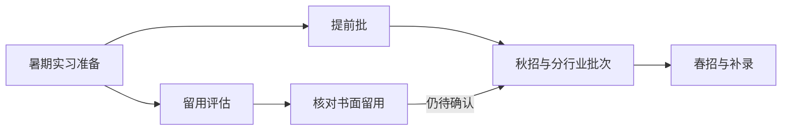

# 全年校招节奏与求职渠道

月份是常见窗口，不是统一日历。每个项目都要回到当期官方公告确认毕业范围、开放日期、截止时间、是否滚动处理和留用规则。用户已经错过一个窗口时，继续检查仍开放岗位、补录、春招、日常实习和社会招聘，不把「秋招结束」等同于全年无机会。

## 从毕业前一年到毕业后的全年窗口

| 常见窗口 | 可能出现的机会 | 这一阶段要做什么 |
| --- | --- | --- |
| 1—3 月 | 暑期实习预热、寒假实习、部分春招和提前项目 | 核毕业届次，准备通用事实卡与目标方向简历 |
| 3—5 月 | 暑期实习集中申请、春招、开放日与学生项目 | 先投有留用说明且匹配的项目，同时保留无留用实习 |
| 5—7 月 | 暑期实习面试与入职、提前批、实习转正考察 | 记录留用评价口径、答辩时间和是否仍需参加正式校招 |
| 7—9 月 | 提前批、秋招启动、实习留用或返聘结果 | 留用未书面确认前继续准备秋招；检查互斥和接受期限 |
| 9—11 月 | 秋招主批次、宣讲会、双选会、统一笔试 | 以截止时间、证据等级和匹配度排投递顺序 |
| 11 月—次年 1 月 | 秋招后段、补录、寒假实习、已发 Offer 与签约 | 更新岗位状态，核对 Offer 截止、三方与退出条件 |
| 次年 2—4 月 | 春招、秋招空缺补录、实习与滚动岗位 | 重新核资格和岗位，不把上一批次结果迁移到新批次 |
| 次年 4—6 月 | 春招后段、毕业前补录、到岗与背调体检 | 同时处理毕业材料、签约文本和入职条件 |
| 毕业后 | 少量补录、滚动岗位、初级社招或往届可投项目 | 只投公告明确接收本人毕业时间和就业状态的岗位 |

### 银行和央国企并行核验

银行秋招常见于秋季主批次，统一笔试可能在网申后另行通知。央国企集团及成员单位的公告可能在秋季分批出现，资格、工作城市、集中笔试与签约主体分别核对。以当期公告为准，两个方向可共用综合能力练习，分别记录官方截止和志愿规则。[银行流程](industry/banking-finance.md) · [央国企流程](industry/state-owned-groups.md)



## 留用要单独建状态

「实习可留用」至少拆成五种，不互相替代：

1. **公告只写有机会留用**：只有可能性，留用比例和标准未公布。
2. **需要考核或答辩**：记录评价维度、时间、负责人和结果通知方式。
3. **免笔试或直通后续面试**：只是流程减免，不等于全职 Offer。
4. **口头告知留用**：标「待书面确认」，继续准备其他校招。
5. **书面全职 Offer**：再核岗位、城市、主体、入职时间、接受期限和签约条件。

问 HR 或导师：

> 想确认本项目的留用口径：是否需要另行申请正式校招、评价或答辩节点、结果预计何时书面通知、留用后的岗位与城市是否与实习一致，以及在结果出来前是否影响申请其他岗位。

## 六类渠道怎么用

| 渠道 | 适合做什么 | 必须补核什么 |
| --- | --- | --- |
| 官网或官方网申 | 查公告、岗位 ID、硬门槛、截止和提交状态 | 是否是本轮项目、岗位是否仍可选、第三方 ATS 是否由官网指向 |
| 内推 | 让材料进入官方系统或获得推荐标记 | 是否仍需网申、内推码与岗位是否对应、是否影响后续志愿；不为内推付费 |
| 校友 | 了解团队、任务和真实工作语境，获得可追问线索 | 校友观点是个人样本；岗位事实仍回到官方公告，不要求其承诺录用 |
| 宣讲会 | 获取本批次说明并现场问规则 | 口头答复记录日期和原话，关键资格、截止和签约口径要求书面确认 |
| 双选会 | 集中接触多家单位、获取岗位或面试线索 | 核主办方、展位主体、岗位原始公告和后续提交渠道 |
| 学校就业平台或就业办 | 获取校内场次、双选会、校招通知和手续支持 | 学校转发是线索；开放状态、岗位条件仍由用人单位官方材料证明 |

## 渠道记录

同一岗位可能由多个渠道出现，只保留一个岗位记录，追加渠道字段：

```markdown
公司与岗位：
官方岗位 ID：
发现渠道：官网 / 内推 / 校友 / 宣讲会 / 双选会 / 学校就业平台
发现时间：YYYY-MM-DD HH:MM（北京时间）
官方公告与网申：
内推人或活动：仅记录必要称呼，不存私人联系方式
是否仍需网申：是 / 否 / 待核
渠道承诺：原话或「无」
下一步与截止：
```

## 组合用法

1. 官网做事实底座。
2. 内推、校友、宣讲会和双选会用于发现、理解和提问。
3. 关键结论回填到同一岗位记录，并标来源和时间。
4. 本人通过官方指定渠道取得提交确认后记「已投递」；只有书面结果才记「已留用」或「已录用」。

## 当前官方例证

- [德勤中国校园招聘常见问题](https://www.deloitte.com/cn/zh/careers/explore-your-fit/students/graduate-faq.html)列出寒暑假实习、全年项目实习，并说明部分优秀实习表现可能带来流程减免；核验时间 2026-11-09。
- [安永中国大陆学生项目](https://www.ey.com/zh_cn/careers/student-programs-in-chinese-mainland)展示毕业生、寒假实习与学生项目，部分项目写明表现优秀者可能获得后续面试或录用机会；核验时间 2026-11-09。
- [毕马威中国校园招聘](https://kpmg.com/cn/en/careers/campus.html)展示毕业生、实习和校园活动入口，并说明毕业生项目滚动审阅；核验时间 2026-11-09。

这些页面只说明各单位当次公开口径，不能推导所有单位的月份、留用比例或流程。
